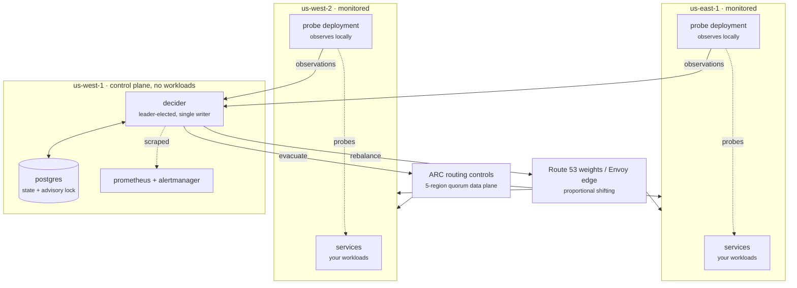
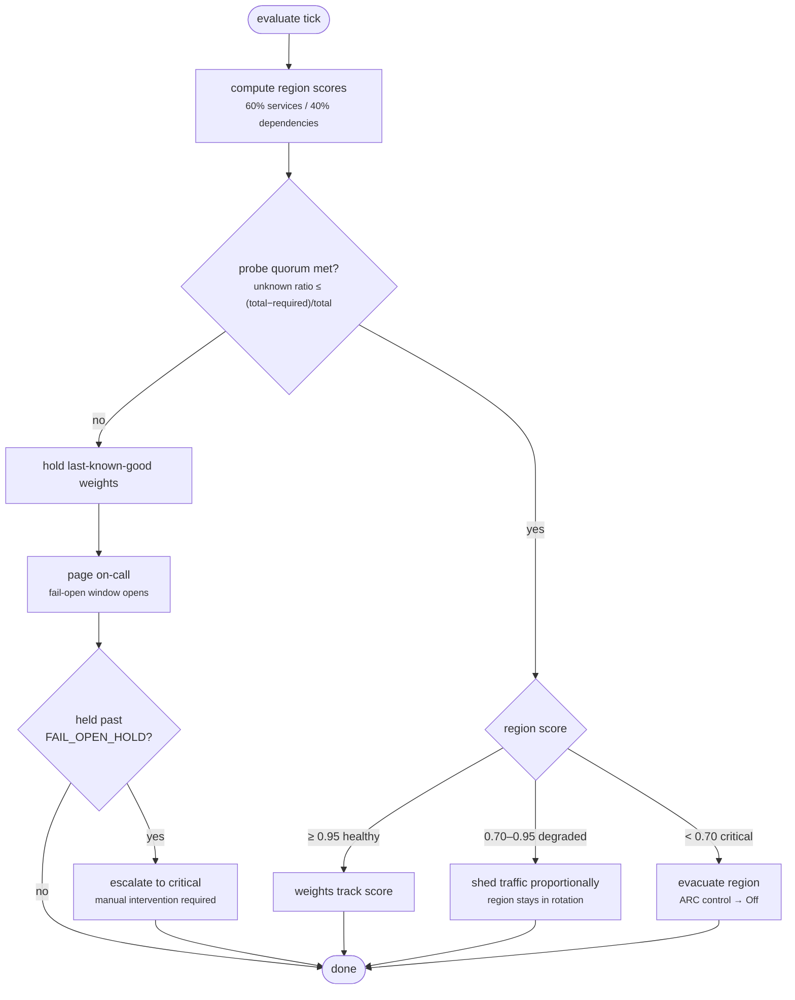

# Deployment architecture and HA scenarios

Companion to [ADR-001](ADR-001-multi-region-topology.md), which carries the
reasoning. This document is the picture and the failure matrix.

Diagrams are Mermaid and render on GitHub.

---

## Target topology

Three properties do the work:

1. **Probes are in-region.** They measure the path customers take.
2. **Exactly one decider, outside both monitored regions.** No split-brain, no
   correlated failure with what it controls.
3. **Two execution paths.** Proportional shifts through weights; evacuation
   through ARC, whose data plane survives a us-east-1 control-plane event.

---

## Decision flow

What the leader does every `EVALUATE_INTERVAL`:

The left branch is the one most health checkers get wrong. "We cannot tell" is
not "it is broken", and it produces a different action: hold, page, wait.

---

## HA scenarios

What actually happens, per failure. **Covered** means the behaviour exists in
code today; **partial** means it works but the deployment shape in ADR-001 is
not fully implemented.

### Data-plane failures — the system acting on the services

| # | Scenario | Detection | Automatic response | RTO | Human action | Status |
|---|---|---|---|---|---|---|
| 1 | One dependency degrades (cache slow) in a region | Dependency probe returns `degraded` | Score drops to ~0.80, weight sheds proportionally, region stays in rotation | ~1 evaluate cycle | None; watch the trend | ✅ Covered |
| 2 | One failover-eligible service fails in a region | 3 consecutive failed probes trip the target | Score drops, weight follows; below 0.70 the region is evacuated | 3 probe intervals + 1 evaluate cycle (~30s at defaults) | Investigate the service | ✅ Covered |
| 3 | A probe flaps (alternating pass/fail) | Hysteresis counter resets on every pass | **Nothing.** Traffic never moves | n/a | Fix the flapping probe | ✅ Covered |
| 4 | An AZ fails inside a region | Subset of targets go critical; others healthy | Partial score drop → proportional shed, not eviction | ~30s | Decide whether to evacuate fully | ✅ Covered |
| 5 | An entire monitored region fails | All targets critical (not unknown — connections refused, not timing out) | Score → 0, region evacuated via ARC | ~30s | Confirm; watch the surviving region's load | ✅ Covered |

### Observation failures — the system unable to see

| # | Scenario | Detection | Automatic response | RTO | Human action | Status |
|---|---|---|---|---|---|---|
| 6 | Transient network blip from the checker | Probes return `unknown`, fewer than `UNKNOWNS_TO_DISTRUST` in a row | **Nothing.** Unknowns are debounced exactly like failures | n/a | None | ✅ Covered |
| 7 | Checker loses visibility of one region | Unknown ratio for that region exceeds tolerance (1/3 at 2-of-3) | Region marked untrusted, weights held, fail-open opens, on-call paged | 1 evaluate cycle | **Required** — decide whether the region is actually down | ✅ Covered |
| 8 | Inter-region partition, both regions healthy | Both regions' unknown ratios spike together | Both untrusted → quorum fails → hold + page. **No failover on an unverified signal** | 1 evaluate cycle | **Required** — this is the split-brain case; a human confirms | ✅ Covered |
| 9 | Fail-open window outlives its hold | `FAIL_OPEN_HOLD` (10m) elapses with signal still inconclusive | Escalates to a critical page; weights still held | 10m | **Required** — the system will not guess | ✅ Covered |
| 10 | Checker restarted mid-incident | Targets seed `unknown`, not `healthy` | Region reads fully inconclusive → distrusted until probes land | `SUCCESS_TO_RECOVER` probes | None | ✅ Covered |

### Control-plane failures — the checker itself

| # | Scenario | Detection | Automatic response | RTO | Human action | Status |
|---|---|---|---|---|---|---|
| 11 | Leader pod dies | Postgres session ends, advisory lock released by the server | A standby acquires the lock and starts its probe fleet | ≤ `LEADER_POLL_INTERVAL` (5s) | None | ✅ Covered |
| 12 | Rolling deploy of the checker | Leader drains, releases the lock | Leadership hands over; probe fleet restarts on the new leader | ~5s, hysteresis counters reset | None | ✅ Covered |
| 13 | Leadership flapping | `hcr_leader_terms_total` climbing across the fleet | None automatic | n/a | **Required** — usually database connection churn | ✅ Alerted |
| 14 | Postgres unavailable | `Evaluate` errors; no lock can be held | Loop errors, weights untouched; `hcr_evaluations_total{outcome="error"}` climbs | n/a | **Required** — no failover is possible while the DB is down | ⚠️ Partial |
| 15 | Checker fully isolated (cannot page) | **Nothing internal.** The process cannot report its own silence | None | n/a | **External only** — `hcr_last_evaluation_timestamp_seconds` goes stale and the dead man's switch fires | ✅ Covered, if Alertmanager is outside |
| 16 | Control-plane region fails | Heartbeat stops fleet-wide; `absent(hcr_leader)` | **None.** No decider, no decisions. Weights frozen at last known good | Indefinite | **Required** — manual ARC flip | ⚠️ By design |

### Execution failures — the routing provider

| # | Scenario | Detection | Automatic response | RTO | Human action | Status |
|---|---|---|---|---|---|---|
| 17 | Route 53 control plane (us-east-1) degraded | `ChangeResourceRecordSets` fails; `hcr_weight_changes_total{outcome="error"}` | Weighted push fails. **ARC path is unaffected** — different data plane | n/a | Use ARC for evacuation | ✅ Covered |
| 18 | One ARC cluster endpoint unreachable | The call fails against that endpoint | Adapter retries the next endpoint in sequence, stops at first success | Milliseconds | None | ✅ Covered |
| 19 | Three or more ARC endpoints unreachable | All configured endpoints fail | Error naming every attempt; weights unchanged | n/a | **Required** — beyond ARC's stated guarantee | ✅ Covered |
| 20 | A change would take every region out of rotation | ARC assertion rule rejects it | Refused, surfaced as a distinct error, **not** retried against other endpoints | n/a | **Required** — usually indicates a scoring bug | ✅ Covered |

---

## What the matrix reveals

**Scenario 16 is the honest limit.** Losing the control-plane region means no
automatic failover at all. That is a deliberate trade, not an oversight: the
fail-open design already treats "cannot decide" as "hold and page" rather than
"guess", so the failure mode is inaction. But it must be understood — **the
system is not self-healing during a control-plane outage**, and the runbook for
it is a manual ARC routing control flip, which works precisely because ARC's
data plane does not depend on the control plane.

**Scenario 15 depends entirely on something outside this system.** If
Alertmanager runs in a monitored region, the outage that silences the checker
silences the alert about it, and scenario 15 degrades from "covered" to
"invisible".

**Scenario 8 is the reason the controller is not active-active.** Two deciders
would each see the other go dark and each claim all traffic. One decider holds
and pages. See ADR-001.

**Scenario 14 is marked partial** because while the behaviour is correct —
errors leave weights untouched — a Postgres outage in the control-plane region
has the same effect as scenario 16, and the current single-instance local
Postgres makes that more likely than it should be. Managed, multi-AZ Postgres is
a prerequisite for production.

---

## Gap against this diagram

The topology above is the target. Today the prober and decider are **one binary
gated by leader election**, so probes run only on the leader, in whichever region
the control plane occupies. Deployed per ADR-001 that means:

- Decision placement: correct
- Signal accuracy: degraded — probes measure from the control-plane region, not
  from inside the monitored ones
- Scenarios 1–5: still work, but latency measurements are cross-region
- Scenario 7: harder to interpret; losing visibility of a region and the region
  being down look more alike from a single external vantage point

Splitting them requires a reporting protocol between probe and decider, and is
the next piece of work. See [production-readiness.md](../docs/production-readiness.md).
